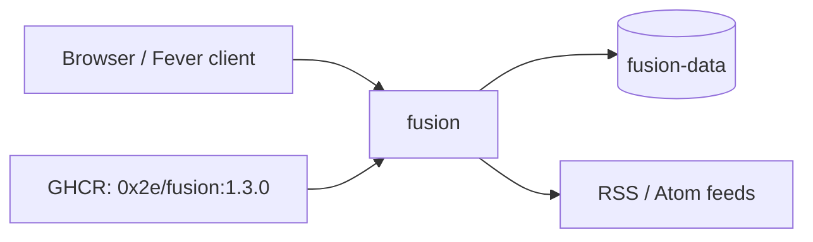

<div align="center">

# Fusion on Render

A lightweight, self-hosted RSS reader. Read, group, bookmark, and search feeds in a fast web UI, or use any Fever API client. This repo is the Blueprint. The app runs from the official [Fusion](https://github.com/0x2E/fusion) image.

<p>
  <a href="https://render.com/deploy-template/api/github/start?template_repo=fusion">
    
  </a>
</p>

<p>
  <a href="https://render.com">
    
  </a>
  <a href="https://github.com/0x2E/fusion">
    
  </a>
  <a href="https://github.com/0x2E/fusion/blob/main/LICENSE">
    
  </a>
</p>

</div>

## What This Template Shows

This repository does not contain the Fusion source. The service pulls the official image from GitHub Container Registry at a pinned version. To upgrade, change the tag in [`render.yaml`](./render.yaml) and push.

| Piece | Role |
| --- | --- |
| **[Fusion](https://github.com/0x2E/fusion)** | Web UI, feed fetcher, and Fever API in one Go binary. |
| **`fusion`** ([Web Service](https://render.com/docs/web-services)) | The app. Pulls feeds every 30 minutes. |
| **`fusion-data`** ([Persistent disk](https://render.com/docs/disks)) | The SQLite database at `/data/fusion.db`. |

## Architecture



### How It Works

1. Click **Deploy to Render**. The flow copies this repo into your GitHub account and applies [`render.yaml`](./render.yaml).
2. Render creates the disk and generates `FUSION_PASSWORD`. There is nothing to fill in.
3. Fusion creates its SQLite database on the disk and starts.
4. Copy `FUSION_PASSWORD` from the service's **Environment** page and sign in.

| Resource | Type | Plan | Notes |
| --- | --- | --- | --- |
| `fusion` | Web, image | Starter | Disk at `/data`, 1 GB. Health: `/api/oidc/enabled`. Single instance. |

Default region: **Oregon**.

## Quick Start

1. Click **Deploy to Render** above.
2. Wait until `fusion` is **Live**.
3. Copy `FUSION_PASSWORD` from the **Environment** page and sign in at the service URL.
4. Add feeds, or import an OPML file from your old reader.

```bash
curl -fsS "https://<fusion>.onrender.com/api/oidc/enabled"
```

## Configuration

| Variable | Source | Description |
| --- | --- | --- |
| `FUSION_PASSWORD` | Generated | Login password. To change it, edit the value and redeploy. |
| `FUSION_DB_PATH` | Blueprint | `/data/fusion.db`, on the disk. |
| `FUSION_PORT` | Blueprint | `8080`. |
| `FUSION_PULL_INTERVAL` | Optional | Seconds between feed refreshes. Default `1800`. |
| `FUSION_OIDC_*` | Optional | Sign in with SSO. See [`.env.example`](./.env.example). |

`generateValue` runs once, on the first Blueprint apply.

### Fever API

Point a Fever client (Reeder, Unread, FeedMe, and others) at `https://<fusion>.onrender.com/fever`. Use `fusion` as the username and `FUSION_PASSWORD` as the password.

## Cost

Prices from [Render's pricing page](https://render.com/pricing).

| Resource | Approx. monthly |
| --- | ---: |
| `fusion` (Starter) | $7 |
| 1 GB disk | $0.25 |
| **Total** | **~$7.25** |

Fusion used under 10 MB of memory in testing. Starter is the smallest plan that supports a disk.

## Troubleshooting

| Problem | Solution |
| --- | --- |
| Feeds and settings disappear after a deploy | Confirm the disk is mounted at `/data` and `FUSION_DB_PATH` is `/data/fusion.db`. |
| Sign-in fails | Use the current `FUSION_PASSWORD` from the **Environment** page. Too many failed attempts block sign-in for 5 minutes. |
| Deploy takes about a minute of downtime | Expected. A service with a disk stops the old instance before it starts the new one. |

## Project Structure

```
render.yaml       Blueprint. One image-backed web service with a disk.
README.md         This file
LICENSE           Wrapper license
.env.example      Optional extras
```

## Learn More

- [Blueprint spec](https://render.com/docs/blueprint-spec)
- [Fusion on GitHub](https://github.com/0x2E/fusion)

## License

[MIT](LICENSE) for this wrapper. Fusion is also [MIT](https://github.com/0x2E/fusion/blob/main/LICENSE).
